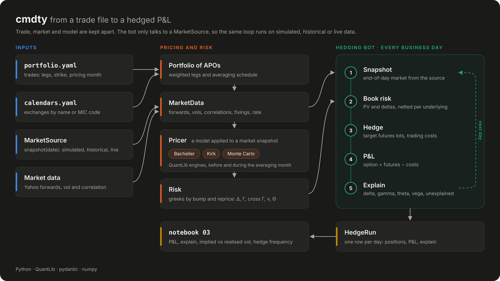

# commodity-hedging

[](https://github.com/MiletoCarmelo/commodity-hedging/actions/workflows/tests.yml)

Pricing and delta hedging of **commodity Average Price Options (APO)** with [QuantLib](https://www.quantlib.org/):
outrights, spreads and cracks on oil futures. The example book holds three trades with
illustrative terms: a Brent put, a WTI - Brent spread put and an HO - Brent crack call. The
crack is the one walked through in detail below.

- **Pricing**: Bachelier, Kirk and Monte Carlo, before and during the averaging month
- **Risk**: greeks by bump and reprice, crack and outright deltas, cross gamma
- **Hedging bot**: a portfolio file, a daily loop that hedges with futures, P&L and P&L explain

## Architecture

The trade, the market and the model are kept apart. A trade never changes, the market is a
new snapshot every day, the model is a choice of the pricer. The bot only talks to a
`MarketSource`, so the same loop will run on simulated, historical or live data.



What each block holds, one map per block: [MarketData](docs/img/map_market.png),
[Pricer](docs/img/map_pricer.png), [HedgingBot](docs/img/map_bot.png). Details in
[docs/](docs/Home.md).

## The example trade

Illustrative terms, chosen for the walkthrough. It is trade APO-003 of the example book
(`portfolios/example_book.yaml`), next to a Brent outright put and a WTI - Brent spread.

| | |
|---|---|
| Underlying | NYMEX NY Harbor ULSD (first nearby, $/gal × 42) − ICE Brent (first line), weights +1 / −1 |
| Averaging | 1–30 June 2027, **common NYMEX ∩ ICE fixing days** (21 days: 18 June is out, NYMEX is closed for Juneteenth while ICE settles) |
| Strike | 32 $/bbl, call, 25 000 bbl, cash-settled |
| Payment | 8 July 2027 (5 business days after the last fixing, 5 July is a US holiday), premium paid upfront |
| Valuation date | 10 Nov 2026: HO 2.50 $/gal, Brent 75 $/bbl, ρ = 0.95, r = 4 % |

## Pipeline

1. **Implied vols**: invert Black-76 on listed ATM options (`ql.blackFormulaImpliedStdDev`).
2. **Fixing schedule**: joint NYMEX/ICE calendar → exact effective time of the discrete average.
3. **Expected payoff** (undiscounted) with three models.
4. **Discounting** to the *payment* date (not the option expiry).
5. **Deltas** per leg by central bump → futures hedge.

## Results

```
Implied vols      : HO 30.00% | Brent 31.99%
Fixings           : 21 common days (June 1st, 2027 -> June 30th, 2027)
T_eff             : 0.5807  | DF 0.9740

model        payoff  PV $/bbl  PV trade $   Δ leg1   Δ leg2   Δ sum
bachelier     2.584     2.517      62,913   +0.399   -0.399  +0.000
kirk          2.686     2.617      65,419   +0.418   -0.401  +0.017
mc            2.667     2.598      64,941   +0.424   -0.406  +0.018
```

**Takeaways**
- **Model risk ≈ 2 500 $** on a 65 k$ premium between the normal and the lognormal view.
- **Bachelier deltas are symmetric** (the model only sees the spread) → hedge = pure crack futures.
  **Lognormal models (Kirk, MC) are not**: Δ_HO + Δ_Brent ≈ +0.017 → ~430 bbl residual outright exposure that a single-delta-per-spread risk system misses.
- Kirk with the T_eff shortcut is within ~0.02 $/bbl of the Monte Carlo on the actual 21 fixings.

## Hedging bot results

Notebook 03: the example book (Brent put bought, WTI - Brent put sold, HO - Brent crack call
sold) is delta hedged every day with futures, lots of 1 000 bbl, 5 $ per lot, on a simulated
market. Each delta is split by the futures contract its fixings use and netted per contract
month; a daily report shows the exposure ladder and every trade with its reason.

On the crack alone, priced at the implied vols, with the market realising more or less:

```
realised vol vs implied (40 paths)   mean P&L $   std P&L $
60%                                    +30,306      11,883
100%                                      +214       9,318
140%                                   -34,540      22,487
```

- The hedge removes the price direction. What is left is a bet on volatility: sold at the
  implied vol, the book earns when the market realises less and loses when it realises more.
- Hedge frequency and model, same paths: daily Kirk 9.5 k$ of P&L dispersion, weekly 16.0 k$,
  daily Bachelier 13.9 k$ (its deltas assume a normal crack), Kirk in barrels instead of whole
  lots 6.6 k$. Rounding the hedge in crack lots is next in the roadmap.

## Models

| Model | Assumption | QuantLib |
|---|---|---|
| Bachelier | spread is normal; $ vol = √(σ₁²F₁² + σ₂²F₂² − 2ρσ₁σ₂F₁F₂) | `bachelierBlackFormula` |
| Kirk | two correlated lognormal legs; (F₂ + K) treated as a second asset | `BasketOption` + `SpreadBasketPayoff` + `KirkEngine` |
| Monte Carlo | correlated driftless GBM futures simulated on each fixing date | NumPy |

Averaging is handled through the exact variance of the discrete average,
T_eff = mean_ij min(t_i, t_j). Engines run with a zero rate (undiscounted payoff), then a
separate `FlatForward` curve discounts to the payment date.

## QuantLib gaps handled here

- **No commodity exchange calendars**: ICE Futures Europe is built from the
  [`holidays`](https://pypi.org/project/holidays/) package (MIC `IFEU`) into a `ql.BespokeCalendar`. ICE Brent settles on
  UK bank holidays, so `UnitedKingdom(Exchange)` would wrongly drop Easter Monday. NYMEX uses the NYSE holiday set as a
  proxy for **settlement** days (Globex keeps trading on some US holidays without publishing regular settlements).
- **No Kirk + averaging engine** → T_eff moment matching, validated against Monte Carlo.
- **`KirkEngine` discounts to expiry**, not to the payment date → priced undiscounted, discounted separately.
- No spread option class in the Python bindings → `BasketOption` with `SpreadBasketPayoff`.

## Market data & calibration (`cmdty.data`)

Desk practice: **vols from the options market** (implied, step 1 above), **correlation from history**
(there is no liquid market for it).

- `YahooFinanceClient`: daily history of continuous futures (`HO=F`, `BZ=F`), dated contracts
  (`futures_price("HO", 2027, 4)` -> `HOJ27.NYM`, front-month fallback), retries,
  explicit errors, closes aligned on common dates and converted to $/bbl.
- `estimate_market_params`: realised vols, correlation and 60-day rolling correlation of log-returns.
- `flag_jumps`: **roll-jump / outlier detection** (robust z-score on median/MAD): continuous
  front-month series jump at each contract roll, which inflates vols and dilutes correlation if left in.

```bash
pip install -e ".[data,notebooks]"
# then open notebooks/02_live_pricing_yahoo.ipynb
```

## Documentation

Notes in [`docs/`](docs/Home.md) (also opens as an Obsidian vault): [pipeline](docs/Pipeline.md), [math](docs/Math.md), [roadmap](docs/Roadmap.md), and one note per package.

## Project layout

```
src/cmdty/
├── instruments/   Leg, AveragingSchedule, APO: contract terms only (no prices)
├── market/        MarketData (date, rate, forwards, vols, correlations), curves, vols, calendars
├── models/        bachelier, kirk, montecarlo: pricing engines, pluggable by name
├── risk/          GreekCalculator (per underlying) and SpreadGreekCalculator (+ crack, outright, corr): bump the market, never the trade
├── pricer.py      Pricer: a model applied to a market snapshot
├── portfolio.py   Portfolio and Trade, loaded from a YAML file
├── hedging/       the bot: hedge per contract month, daily loop, report, P&L explain
├── plotting.py    dark chart style used by the notebooks
└── data/          Yahoo Finance client, vol/correlation estimation, roll-jump detection
portfolios/  config/  tests/  notebooks/
```

Three things are kept apart, as in a trading system: the **trade** (fixed for its whole life),
the **market** (a new snapshot every day) and the **model**. Sensitivities bump the market
snapshot and reprice the same trade. Everything is validated at construction with pydantic.

## Usage

```bash
pip install -e ".[dev]"
jupyter lab notebooks/   # 01: pricing walkthrough, 02: live pricing from Yahoo, 03: hedging bot
pytest -q
```

```python
market = MarketData(today="2026-11-10", rate=0.04,
                    quotes={"HO": Quote(105.0, 0.30), "BRENT": Quote(75.0, 0.32), "WTI": Quote(71.0, 0.33)},
                    correlations={("HO", "BRENT"): 0.95, ("WTI", "BRENT"): 0.97, ("HO", "WTI"): 0.93})

schedule = AveragingSchedule(pricing_period="2027-06", pay_lag=5,
                             calendar=joint_exchange_calendar(["NYMEX", "ICE-EU"]))
apo = APO(legs=[Leg("HO", 1), Leg("BRENT", -1)], strike=32.0, schedule=schedule)

pricer = Pricer(model="kirk", market=market)
pricer.pv(apo)                       # PV, $/bbl
pricer.deltas(apo)                   # {"HO": ..., "BRENT": ...}
pricer.greeks(apo)                   # all sensitivities
pricer.with_model("mc").pv(apo)      # same market, another model
```

`premium_style="futures_style"` on the contract gives DF = 1 (margined daily, like listed APOs); the default `"upfront"` discounts from the pay date.

Generic by design: legs are a weighted list, so the same `APO` covers an outright (one leg), any two-leg spread (gasoil–Brent, WTI–Brent, ratio cracks with a weight like -1.1) and a 3-2-1 crack. Kirk is limited to two legs, Bachelier and Monte Carlo take any number.

Hedging bot:

```python
book = load_portfolio("portfolios/example_book.yaml")
source = SimulatedSource(market, ql.Date(15, 7, 2027), any_exchange_calendar(["NYMEX", "ICE-EU"]),
                         realized_vol={"HO": 0.25, "BRENT": 0.27, "WTI": 0.28}, seed=7)
run = HedgingBot(book, source, load_hedge_settings("config/hedging.yaml")).run()
run.total_pnl                        # hedged P&L after costs, $
run.to_frame()                       # one row per day: forwards, PV, deltas, lots, P&L, explain
print(daily_report(run, ql.Date(20, 4, 2027)))   # exposure per contract, trades and why
```

## Roadmap

Full roadmap in [docs/Roadmap.md](docs/Roadmap.md): futures curve and contract roll next,
then historical data and a systematic strategy.

- [x] Valuation **inside** the averaging period (fixed fixings → adjusted strike K*, decaying delta)
- [x] Walkthrough notebook with PV/delta profiles
- [x] Hedging bot on a simulated market, P&L explain
- [x] Historical correlation from Yahoo Finance with roll-jump detection
- [x] Live forwards from the dated contracts each leg references (`market/futures.py`: month codes, first nearby)
- [ ] Data-quality / anomaly checks on implied vol surfaces

## Limitations

Flat vols and correlation, single curve, one forward per underlying (no contract roll yet),
approximated exchange calendars: check official holiday calendars before any production use.
The hedging bot runs on a simulated market for now. Educational project.
