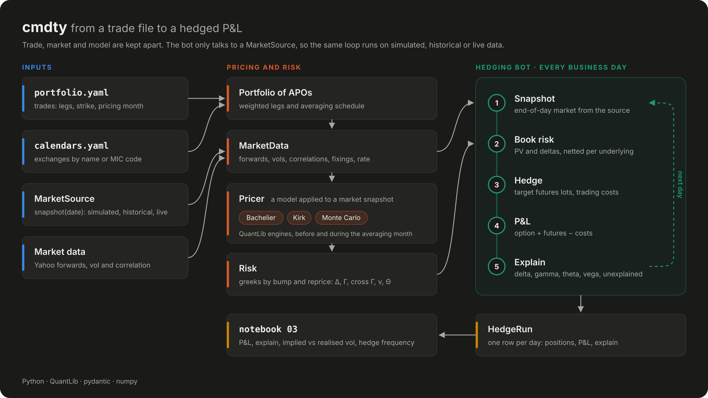

# cmdty docs

Notes on how the pricer and the hedging bot work. Open this folder as an Obsidian vault, or just read it on GitHub.

- [Study](Study.md): goals, hypotheses, results, problems met, limitations
- [Findings](Findings.md): bugs and surprises found along the way, and what they taught
- [Pipeline](Pipeline.md): what happens from contract to greeks
- [Roadmap](Roadmap.md): where the repo is going
- [Math](Math.md): all the formulas used in the code
- Code, one note per package:
  - [instruments](code/instruments.md): the contract
  - [market](code/market.md): market data and conventions
  - [models](code/models.md): Bachelier, Kirk, Monte Carlo
  - [pricer](code/pricer.md): model + market
  - [risk](code/risk.md): greeks
  - [portfolio](code/portfolio.md): trades from a YAML file
  - [hedging](code/hedging.md): the hedging bot
  - [data](code/data.md): Yahoo Finance and estimation
  - [plotting](code/plotting.md): chart style

The worked example is a call on the Jun-27 average of the NY Harbor ULSD - Brent crack,
strike 32 $/bbl, 25 000 bbl, one of the three trades of `portfolios/example_book.yaml`.
The terms are made up for illustration.
