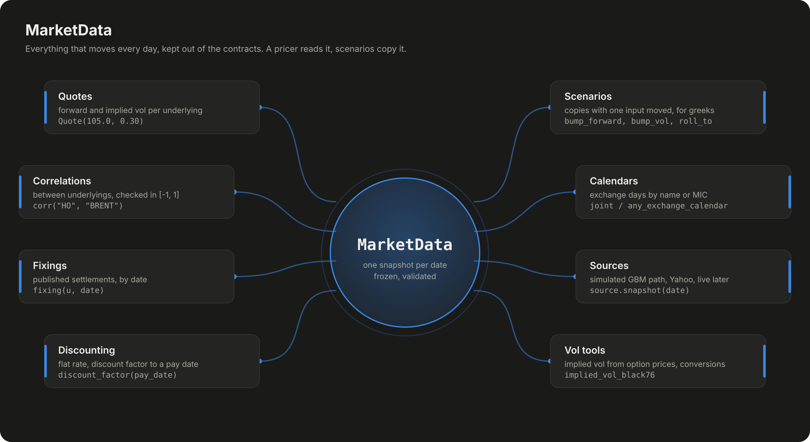
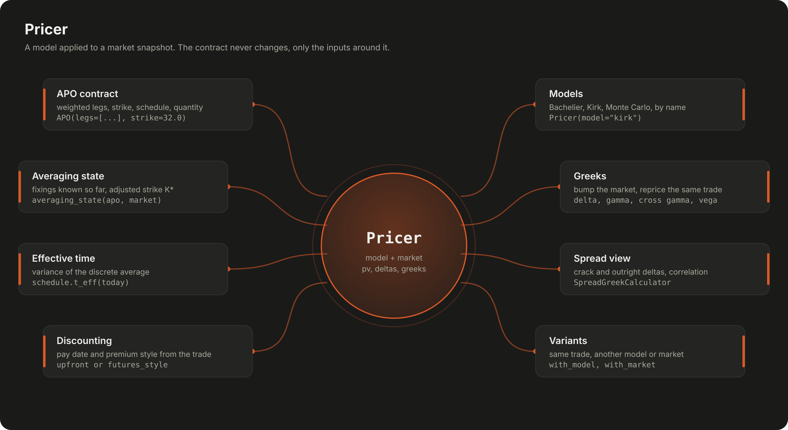
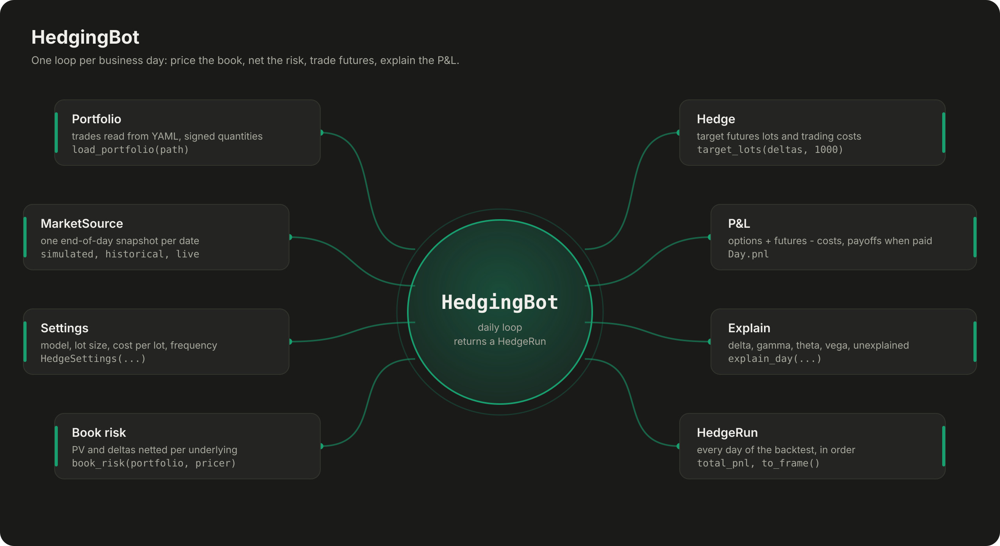

# Pipeline

Back to [Home](Home.md)

Three things are kept apart: the trade (never changes), the market (a new snapshot every day)
and the model. Then the hedging bot runs the same steps every day.

## 1. Contract

`APO`: a list of weighted legs, strike, call/put, quantity, premium style, and an
`AveragingSchedule` (pricing month, fixing calendar, payment lag). No prices in here.

The fixing calendar is the intersection of NYMEX and ICE days (ISDA "Common Pricing"). For
Jun-27 that gives 21 fixings: 18 June is out because NYMEX is closed (Juneteenth), even though
ICE Brent settles.

## 2. Market

`MarketData`: valuation date, discount rate, one `Quote` (forward, vol) per underlying, and
the correlations.

- forwards: the futures each leg references (HO Jul-27, Brent Aug-27)
- vols: implied from listed options, Black-76 inverted
- correlation: estimated on history, roll jumps removed (notebook 02)

## 3. Expected payoff

Expected value of the payoff on the **average** of the crack over the fixings, not on the
crack at expiry. Undiscounted. Three models, see [Math](Math.md):

- Bachelier: the crack is normal
- Kirk: each leg is lognormal, closed-form approximation
- Monte Carlo: both legs simulated on the 21 real fixing dates (the benchmark)

## 4. Discounting

PV = DF(pay date) x expected payoff. DF = 1 if the premium is futures-style margined.

## 5. Greeks

Move one market input, reprice the whole PV, take the difference. The trade never moves.
Deltas per leg, crack and outright, gammas, vegas, correlation, theta, rho.

## 6. Hedging

The bot reads the portfolio file, takes one market snapshot per business day, prices every
trade, nets the deltas per underlying and holds the opposite in futures, rounded to lots.
P&L every day: option, futures, costs, and the explain by greek. See
[hedging](code/hedging.md).

## Numbers (10 Nov 2026 snapshot)

| model | PV $/bbl | delta HO | delta Brent |
|---|---|---|---|
| Bachelier | 2.517 | +0.399 | -0.399 |
| Kirk | 2.617 | +0.418 | -0.401 |
| Monte Carlo | 2.598 | +0.424 | -0.406 |
