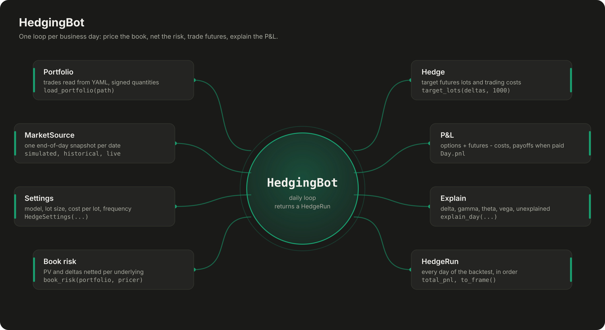

# hedging

Back to [Home](../Home.md)



The bot: delta hedge the portfolio with futures, once per business day, and book the P&L.
Backtest mode for now, on a [simulated market](market.md#sourcespy).

```python
book = load_portfolio("portfolios/example_book.yaml")
source = SimulatedSource(market, end, any_exchange_calendar(["NYMEX", "ICE-EU"]), seed=7)
result = HedgingBot(book, source, HedgeSettings(cost_per_lot=5)).run()
result.to_frame()          # one row per day
```

## One day, end of day

1. take the market snapshot of the date
2. price every trade, add up the deltas per underlying (netting)
3. P&L since yesterday, with yesterday's futures:
   - option: change in PV, plus the cash if a trade paid today
   - hedge: lots x 1000 bbl x change in the futures price (variation margin)
4. new position = deltas turned into lots with the opposite sign, rounded
5. cost = lots traded x cost per lot

## settings.py

- `HedgeSettings`: `model`, `lot_size` (1000 bbl), `cost_per_lot`, `rebalance_every` (days).
  Desk choices, so they live here and not in the portfolio file.

## engine.py

- `target_lots(deltas, lot_size)`: futures that cancel the deltas, the only decision of the bot
- `HedgingBot(portfolio, source, settings).run()`: the loop above, returns a `HedgeRun`.
  It reads the book risk from [risk/book.py](risk.md#bookpy) and decides what to trade
- `Day`: everything about one date (forwards, PV, deltas, position, trades, P&L lines)
- `HedgeRun`: the list of days, `total_pnl`, `cumulative_pnl()`, `to_frame()`

## explain.py

The option P&L of each day, split with yesterday's greeks:

dV ~ delta dF + 1/2 gamma dF² + theta dt + vega dvol, plus the payoff when it is paid.

- gamma is a matrix: HO, Brent and the HO x Brent cross term (`cross_gamma` in risk)
- theta is yesterday's market moved to today's date, nothing else changed
- `unexplained` is what is left, around 1 to 2% of the daily moves. It grows when an option
  is at the money close to the end of its month: gamma itself moves a lot within a day
- `HedgeSettings(explain=False)` skips it, about 3x faster for many-path studies

Read with the hedge: delta of the option + futures P&L is close to 0, so the hedged P&L is
mostly gamma against theta. That is the volatility bet of a hedged option.

## What the tests check

- the hedge of a sold crack call is long HO, short Brent
- Brent is netted across the three trades of the example book
- P&L bookkeeping: hedge P&L is exactly lots x size x price change, costs per lot
- summed option P&L = payoff paid - premium received
- sold option, realised vol below implied: the hedged book makes money on average, above: it
  loses. The hedge removes the direction, what is left is the volatility bet
- the hedge cuts the P&L dispersion by more than half
- explain lines add up to the option P&L, unexplained under 2% of the moves
