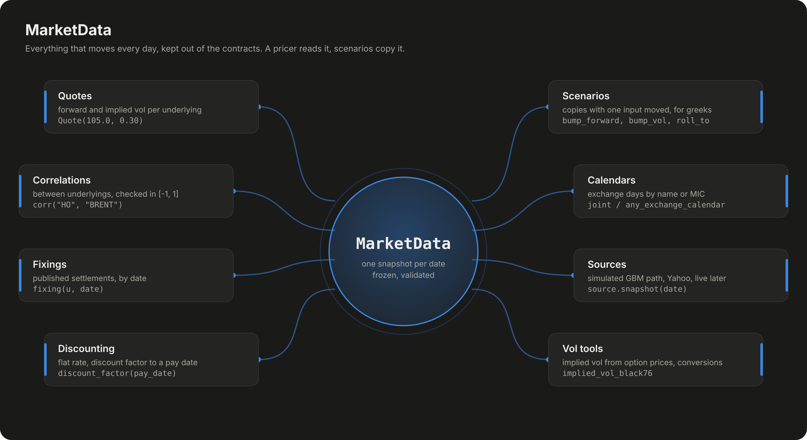

# market

Back to [Home](../Home.md)

Market data and market conventions.

## market_data.py

- `Quote(forward, vol)`: one underlying. Forward > 0, vol in (0, 5].
- `MarketData`: valuation date, discount rate, quotes by underlying, correlations by pair,
  published fixings by underlying and date.
  - `forward(u)`, `vol(u)`, `quote(u)`: lookups, clear error if the underlying is missing
  - `corr(a, b)`: works in both orders, 1 for the same underlying
  - `fixing(u, date)`, `with_fixings(u, {date: price})`
  - `discount_factor(pay_date)`: flat curve at the rate
  - scenarios, each returns a new snapshot and leaves the original alone:
    `bump_forward`, `bump_vol`, `bump_corr`, `bump_rate`, `roll_to`. `roll_to` fills the
    skipped days with the current forward as fixing (the market did not move).

## calendars.py

1. `calendar_from_holidays(mic)`: builds a QuantLib calendar from the `holidays` package
   (e.g. `"IFEU"`, `"XNYS"`).
2. Exchange calendars:
   - `nymex_calendar()`: NYSE holidays, used as a proxy for NYMEX **settlement** days
   - `cme_calendar()`: CME Globex **trading** days. Globex trades on MLK day etc. without a
     regular settlement, so not used for fixings.
   - `ice_futures_europe_calendar()`: ICE Brent, closed only New Year, Good Friday, Christmas
3. Generic:
   - `joint_calendar(*cals)`: days open on all of them
   - `business_days(cal, start, end)`
4. By exchange, what the portfolio file uses:
   - `exchange_calendar("NYMEX")` or `exchange_calendar("XNYM")`, by name or MIC
   - `joint_exchange_calendar(["NYMEX", "ICE-EU"])`
   - `any_exchange_calendar(codes)`: days when at least one exchange is open, the stepping
     calendar of a simulation whose trades fix on different exchanges
   - `available_calendars()`: every code that works
   - the table lives in `market/calendars.yaml` (name, MIC, function, settlement or trading
     days, note). Open it to know what to put in the portfolio file. Names are explicit on
     purpose: "ICE" alone could be ICE Europe or ICE US.

## dates.py

- `to_ql_date`: accepts `ql.Date`, `datetime.date` or `"YYYY-MM-DD"`
- `DateRange(start, end)`: also accepts a month code, `"2027-03"`.
  `DateRange.month(2027, 3)`, `is_month()`, `str()` gives back `"2027-03"`.
- `MonthRange`: a `DateRange` that must be one whole month

## futures.py

- `month_code(4)` -> `"J"` (F G H J K M N Q U V X Z)
- `contract_symbol("HO", 2027, 4)` -> `"HOJ27"`
- `nearby_contract(2027, 3, months_ahead)`: contract a leg fixes on during the pricing month.
  HO uses the next month, Brent the one after.

## vol.py

1. Implied vols: `implied_vol_black76`, `implied_vol_normal`
2. Generic: `lognormal_to_normal_vol`, `normal_to_lognormal_vol` (ATM approximation),
   `spread_vol(v1, v2, rho)`. See [Math](../Math.md#spread-vol-in-dollars).

## curves.py

- `flat_discount_factor(today, pay_date, rate)`: continuous compounding. A desk would
  bootstrap a SOFR curve, the difference is a few dollars here.

## units.py

- `GAL_PER_BBL = 42`

## sources.py

Where the hedging bot gets its market, one end-of-day snapshot per date.

- `MarketSource`: the interface, `dates()` and `snapshot(date)`. Historical and live sources
  will follow it.
- `SimulatedSource(start, end, calendar, realized_vol=None, realized_corr=None, seed=0)`:
  one random path of the futures from the `start` market, driftless GBM on the calendar's
  business days.
  - the path moves with `realized_vol` / `realized_corr`, the pricer keeps seeing the implied
    vols of `start`. Both default to the implied ones
  - snapshots are end of day: the day's settlement is the forward and already the day's
    fixing, so the APO fixes along the path
  - same seed, same path
  - one forward per underlying, no contract roll (see [Roadmap](../Roadmap.md))
