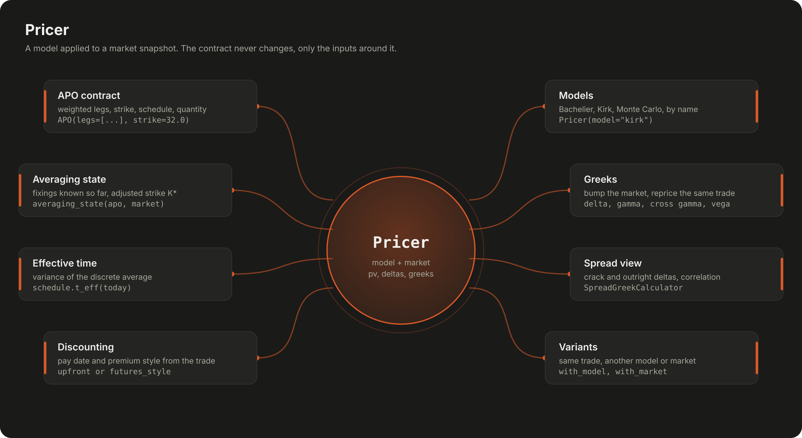

# pricer

Back to [Home](../Home.md)



`Pricer(model="kirk", market=market)`: a model applied to a market snapshot. Same idea as
`setPricingEngine` in QuantLib, but the instrument is not modified.

- `expected_payoff(apo)`: calls the model
- `discount_factor(apo)`: market rate read at the trade's pay date, 1 if futures-style
- `pv(apo)`: discount factor x expected payoff, 0 after the pay date
- `risk(apo)`: a `SpreadGreekCalculator` for two legs, a `GreekCalculator` otherwise
- `deltas(apo)`: dict of delta per underlying, any number of legs
- `greeks(apo)`: everything at once, two-leg spreads only
- `with_model`, `with_market`, `with_model_kwargs`: same pricer with one thing changed

```python
pricer = Pricer(model="kirk", market=market)
pricer.pv(apo)
pricer.with_model("mc").pv(apo)
pricer.risk(apo).vega_legs()
```
